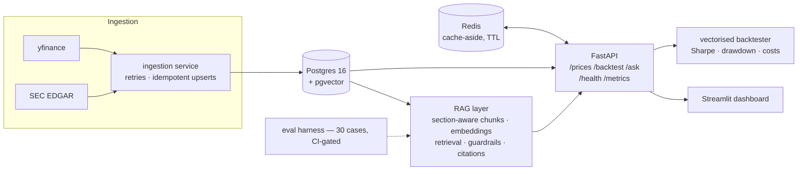

# FilingsDesk

[](../../actions/workflows/ci.yml)


**A market-intelligence platform**: ingests prices and SEC filings into Postgres, serves
them through a cached FastAPI, runs vectorised backtests with transaction costs and
look-ahead-bias protection, and answers natural-language questions about filings with
**verbatim citations** — kept honest by an **eval harness that runs in CI**.



## Quickstart

```bash
docker compose up --build
```

That's the whole thing: Postgres (pgvector), Redis, the API (auto-migrated), an ingestion
worker that seeds deterministic demo data, and the dashboard.

- API + OpenAPI docs → http://localhost:8000/docs
- Dashboard → http://localhost:8501

<details>
<summary>Local development without Docker</summary>

```bash
python3 -m venv .venv && .venv/bin/pip install -e ".[dev,dashboard]"
createdb filingsdesk && .venv/bin/alembic upgrade head
.venv/bin/filingsdesk-ingest --fixtures        # offline demo data (or omit --fixtures for live yfinance/EDGAR)
.venv/bin/uvicorn filingsdesk.api.main:app --reload
.venv/bin/streamlit run src/filingsdesk/dashboard/app.py
```

No Redis? No pgvector? Fine — the cache falls back to in-memory and the vector store to
exact numpy search, with log lines saying so. CI runs the full stack.
</details>

## Try it

```bash
# Latest quote (second call comes from Redis — note "cached": true)
curl localhost:8000/prices/AAPL/latest

# Backtest a 20/50 moving-average crossover with 10 bps costs
curl -X POST localhost:8000/backtest -H 'content-type: application/json' \
  -d '{"symbol": "AAPL", "strategy": "ma_crossover", "params": {"fast": 20, "slow": 50}, "cost_bps": 10}'

# Ask the filings — answers are verbatim quotes with citations
curl -X POST localhost:8000/ask -H 'content-type: application/json' \
  -d '{"question": "How fast did Apple'\''s Services segment net sales grow?"}'
```

## What's actually in here

**Backtesting engine** (`backtester/`) — vectorised pandas/NumPy. The no-look-ahead
guarantee is a single audited line (`positions = signal.shift(1)`) at the engine boundary,
so strategies *cannot* peek even if they try — and a Hypothesis property test proves
appending a future bar never changes past equity. Transaction costs are charged on every
position change. Metrics: Sharpe, max drawdown, CAGR, volatility — validated against
hand-computed vectors.

**Crash-safe ingestion** (`ingestion/`) — every write is an `INSERT … ON CONFLICT` upsert
keyed on natural constraints (`instrument+date`, EDGAR `accession_no`), one transaction
per symbol, retries with exponential backoff and jitter, structured JSON logs. Kill it
mid-run and re-run: it converges to the same state (that's a test, not a claim —
`tests/integration/test_ingestion_db.py`).

**RAG with receipts** (`rag/`) — section-aware chunking of filings (`ITEM 1A…` labels
survive into citations), pluggable embeddings (default: deterministic hashing embedder —
keyless, CI-friendly), pgvector or numpy retrieval, and an **extractive answerer**: every
answer sentence is a verbatim quote from a cited filing. It can be wrong; it cannot
hallucinate. Guardrails: out-of-corpus refusal, low-confidence flagging, and
prompt-injection screening that quarantines documents addressing the assistant.

**Evals in CI** (`evals/`, `rag/evals.py`) — 25 QA pairs + 5 refusal probes over a bundled
fixture corpus. CI fails if retrieval hit rate < 0.8 or faithfulness < 0.9. Current
numbers with the keyless embedder:

| metric | result |
|---|---|
| retrieval hit rate (top-5) | **1.00** |
| answer faithfulness | **1.00** |
| keyword recall | 0.92 |
| refusal accuracy | 0.80 |

The 0.80 refusal accuracy is an honest lexical-embedder failure worth knowing about:
"What is the capital of France?" retrieves *capital expenditure* sentences. A semantic
embedding provider (one config switch, ADR-0006) fixes it; the eval harness is exactly
what caught it.

**Observability** — structured request logs, `/health` (checks the DB), Prometheus
`/metrics`: request rate/latency by route template, cache hit/miss counters.

## Design decisions

Every significant choice has an ADR written *before* the component:

| ADR | Decision |
|---|---|
| [0001](docs/adr/0001-postgres-over-sqlite.md) | Postgres over SQLite (concurrency, upserts, pgvector) |
| [0002](docs/adr/0002-redis-cache-aside.md) | Cache-aside + TTL; the cache may die, the API may not |
| [0003](docs/adr/0003-vectorised-backtester.md) | Vectorised engine; look-ahead guard in one audited line |
| [0004](docs/adr/0004-pgvector-over-dedicated-vector-db.md) | pgvector over a vector DB; numpy fallback |
| [0005](docs/adr/0005-chunking-strategy.md) | Section-aware chunking — *measured* against fixed-size |
| [0006](docs/adr/0006-keyless-ai-providers.md) | Keyless-by-default AI providers; extractive answers |

Full architecture and failure-mode analysis: [docs/design.md](docs/design.md).
Deployment (compose / Fly.io): [docs/deploy.md](docs/deploy.md).

## Testing

```bash
pytest -m "not integration"   # fast: unit + property tests, no services
pytest --cov                  # full: + integration against real Postgres
filingsdesk-evals --dataset evals/dataset.jsonl --min-hit-rate 0.8 --min-faithfulness 0.9
```

85 tests, ~91% coverage on core modules: unit tests against hand-computed values,
integration tests against real Postgres, property-based tests (Hypothesis) for engine
invariants — positivity, capital preservation, cost monotonicity, causality.

## Honest limitations

- Fixture filings are **synthetic** (clearly labelled in every document) so demos, tests,
  and evals run offline and deterministically; live EDGAR/yfinance ingestion is built in.
- The default embedder is lexical, not semantic — see eval table above; swap in a cloud
  provider via config for production-quality retrieval.
- Daily-bar backtests: no intrabar execution, slippage curves, or order queuing (ADR-0003).
- At 100× scale: queue between ingestion and DB, partition `prices`, read replicas, async
  backtest workers (docs/design.md).
