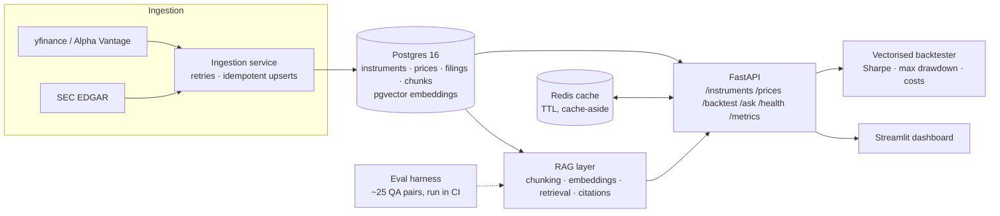

# FilingsDesk — system design

## Problem

Analysts need three things in one place: reliable market data, primary-source documents
(SEC filings), and the ability to test ideas against history. FilingsDesk ingests prices and
filings, stores them in a normalised relational schema, exposes them through a typed API,
runs vectorised backtests, and answers natural-language questions about filings with
citations — with an eval harness that keeps the AI layer honest.

## Architecture

## Data flow

1. **Ingest** — scheduler (APScheduler / cron container) pulls daily OHLCV per instrument and
   new EDGAR filings. Every write is an upsert keyed on a natural unique constraint
   (`instrument_id + date`, EDGAR `accession_no`), so re-running after a crash is safe.
2. **Store** — normalised tables; indexes on every query path (see schema below).
3. **Serve** — FastAPI reads through the cache (cache-aside): hot reads (latest quote) hit
   Redis with a short TTL; misses fall through to Postgres and populate the cache.
4. **Backtest** — `/backtest` accepts a strategy config, loads prices into a DataFrame, runs
   the vectorised engine, returns equity curve + metrics.
5. **Ask** — `/ask` embeds the question, retrieves top-k chunks (pgvector or numpy fallback),
   applies guardrails, and returns an answer with citations to specific filings.

## Schema (core tables)

| table | key columns | notes |
|---|---|---|
| `instruments` | `id`, `symbol` (unique), `name`, `exchange`, `currency` | reference data |
| `prices` | `instrument_id`, `date`, OHLCV — unique `(instrument_id, date)` | index on `(instrument_id, date DESC)` |
| `filings` | `accession_no` (unique), `instrument_id`, `form_type`, `filed_at`, `title`, `body` | full text kept for chunking |
| `filing_chunks` | `filing_id`, `chunk_index`, `section`, `text`, `embedding vector(384)` | embedding column added by conditional migration (ADR-0004) |

## Failure modes considered

- **Ingestion dies mid-run** → idempotent upserts + per-instrument transactions mean a re-run
  converges to the same state; no dedupe pass needed (ADR, README "crash-safe re-ingestion").
- **Upstream API flaps** → tenacity retries with exponential backoff + jitter; structured logs
  record every retry with context.
- **Redis down** → cache layer degrades to a no-op/in-memory cache; reads fall through to
  Postgres. The API never hard-depends on Redis (ADR-0002).
- **pgvector unavailable** (local dev) → numpy vector store computes cosine similarity in
  memory over embeddings persisted by the portable path (ADR-0004).
- **LLM/embedding API keys absent** → deterministic local embedder + extractive answerer keep
  the whole pipeline (and CI evals) runnable keyless (ADR-0006).

## At 100× scale (interview answer, and honest roadmap)

Queue (e.g. SQS/Redpanda) between ingestion and DB writes; partition `prices` by date; read
replicas for the API; move backtests to async workers with result storage; dedicated vector DB
only if pgvector's HNSW stops fitting in memory.

## Decisions

Each significant decision has an ADR in `docs/adr/`:
0001 Postgres over SQLite · 0002 Redis cache-aside · 0003 vectorised backtester ·
0004 pgvector (+fallback) · 0005 chunking strategy · 0006 keyless-by-default AI providers.
